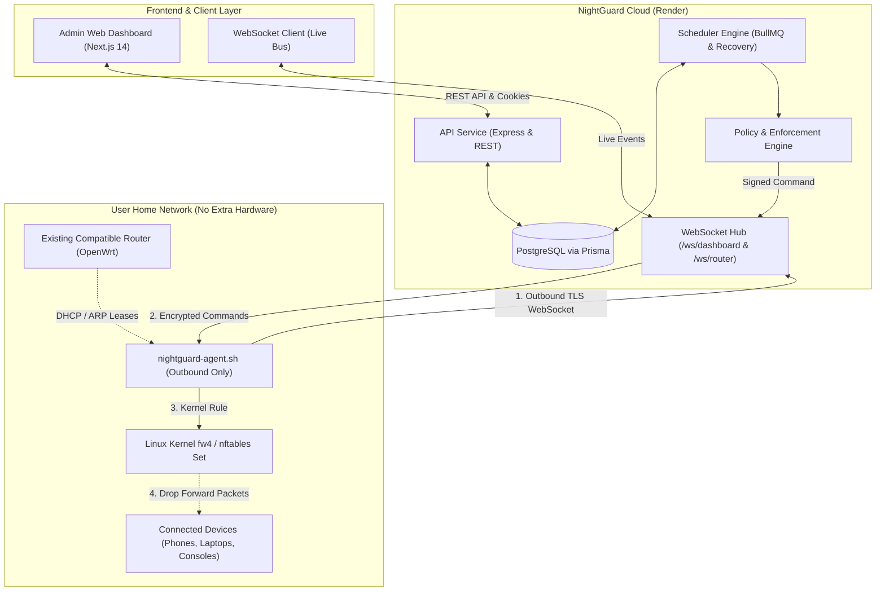

# NightGuard Architecture & Engineering Specification

## 1. System Overview

NightGuard is a hardware-free, router-native digital wellbeing and access scheduling platform. It allows administrators to automate internet access restrictions for specific devices connected to their Wi-Fi network according to bedtime or focus schedules.



---

## 2. Router Integration Architecture

### The NAT & Private IP Boundary
A cloud server hosted on Render cannot directly reach private addresses such as `192.168.1.1` behind residential Carrier-Grade NAT (CGNAT) or home firewalls.
Traditional solutions (such as requiring port forwarding or DDNS) create severe security vulnerabilities and are fragile.

**NightGuard's Solution:**
1. **Outbound-Only Connection**: Software running on the router (`nightguard-agent`) initiates an outbound TLS connection to `wss://api.nightguard.render.com/ws/router`.
2. **No Inbound Open Ports**: The router exposes zero ports to the public internet.
3. **Firewall4 & nftables Kernel Enforcement**:
   - Restrictions are placed at the router's packet forwarding level:
     ```sh
     nft add set inet fw4 nightguard_mac_blocked { type ether_addr \; }
     nft insert rule inet fw4 forward ether saddr @nightguard_mac_blocked counter drop
     ```
   - When restricted: `nft add element inet fw4 nightguard_mac_blocked { <mac> }`
   - When restored: `nft delete element inet fw4 nightguard_mac_blocked { <mac> }`
   - Local LAN traffic (e.g. printing, local smart home devices) and router DNS/DHCP queries remain functioning; only outgoing internet forwarding is dropped.

---

## 3. Scheduling & Policy Engine

### Midnight-Crossing Schedules
Schedules commonly span across midnight (e.g., Start: `10:00 PM` [22:00], End: `7:00 AM` [07:00]).
- If $Start > End$, the policy window begins in the evening of Day $D$ and terminates on the morning of Day $D+1$.
- NightGuard evaluates both whether the current time is in the evening segment (using Day $D$) or morning segment (using the previous day's selection).

### Recovery and Reliability
- **Restart Recovery**: Whenever the API or background worker restarts, it immediately scans all devices, recalculates expected states against router firewall tables, and reapplies missing rules.
- **Deduplication**: Every scheduled command contains a deterministic idempotency key (`routerId:commandType:mac:timestamp`) preventing duplicate execution.
